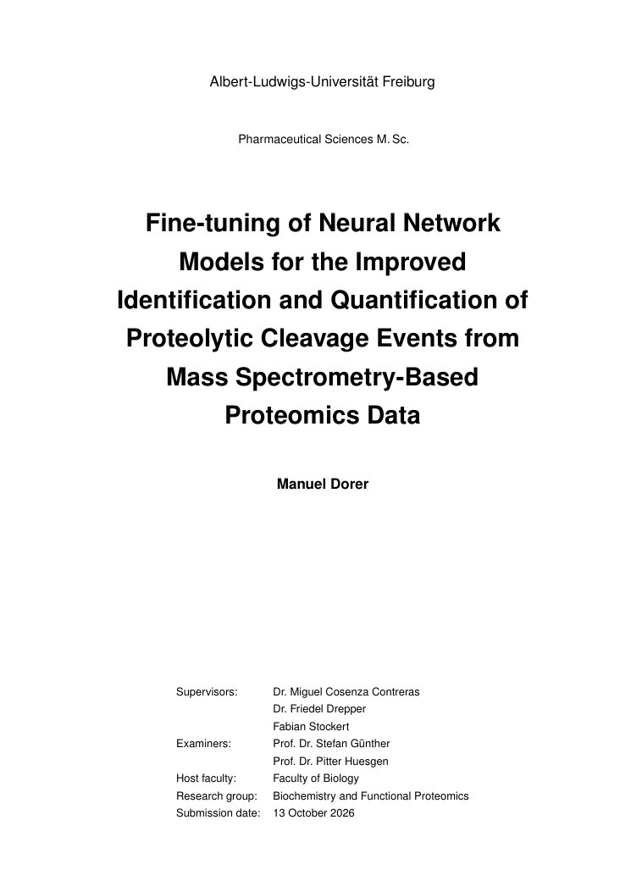
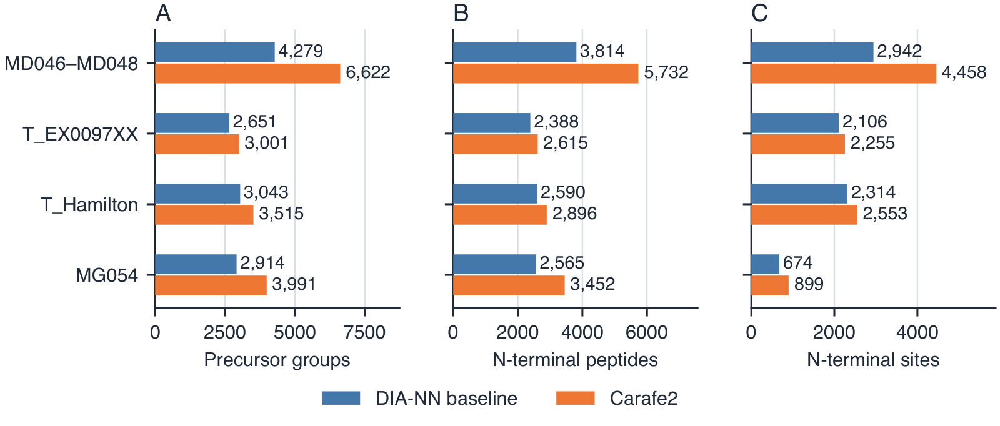
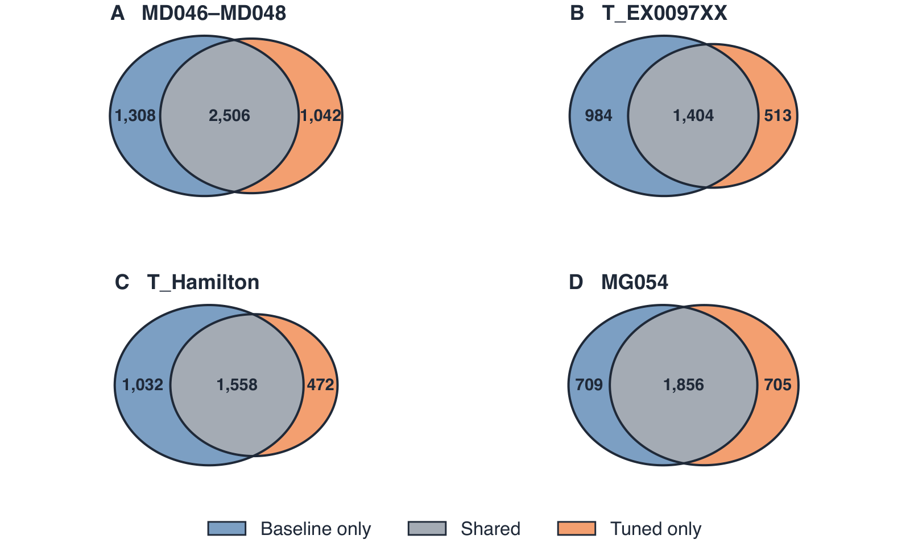
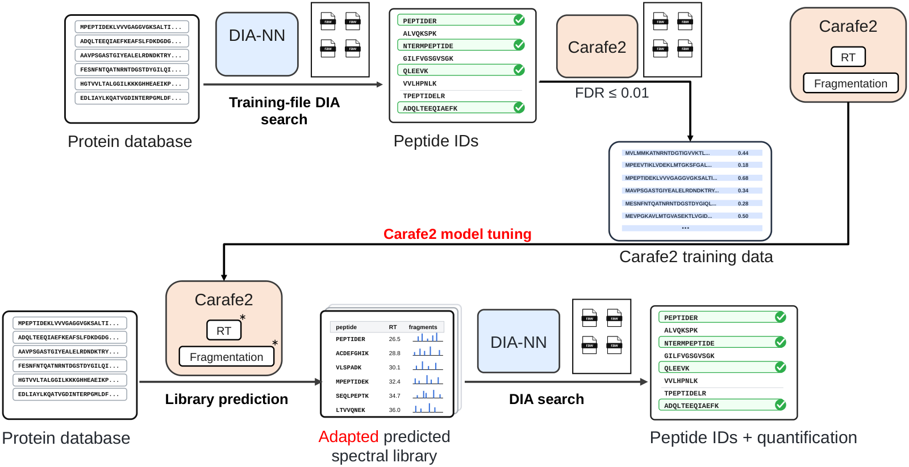

# HUNTER DIA model adaptation

**Manuel Dorer · Master's thesis · University of Freiburg · 2026**

*Fine-tuning of Neural Network Models for the Improved Identification and
Quantification of Proteolytic Cleavage Events from Mass Spectrometry-Based
Proteomics Data*

Can adapting peptide-property models improve the identification of enriched
N-terminal peptides? This thesis compares integrated DIA-NN tuning, a
HUNTER-compatible Carafe2 workflow and external retention-time fine-tuning
across four datasets, using separate training and held-out search files.

[**Read the thesis (PDF)**](resources/Manuel_Dorer_Master_Thesis_public.pdf)
· [Key findings](#key-findings)
· [Software](#software-and-analysis-components)
· [Benchmark inputs](#benchmark-inputs)

The PDF is a redacted, unsigned copy of the submitted thesis. Black bars remove
the student identifier and internal storage information. The scientific text,
results and page layout have not been rewritten. See the
[edition notes](docs/thesis-edition.md).

## Key findings

- **The tested integrated DIA-NN tuning reduced Heavy-N site coverage in all four datasets.**
- **The integrated Carafe2 workflow increased site coverage by approximately 7–52%**
  relative to the unchanged-model DIA-NN baseline. Differences in models,
  libraries and database configurations mean this is a workflow comparison;
  the gain cannot be attributed to model adaptation alone.
- **Small improvements in RT prediction did not consistently increase identification coverage.**
  Selected external workflows did not consistently outperform the baseline or
  corresponding integrated workflow.

Here, Heavy-N denotes heavy dimethylation at the peptide N-terminus. Site counts
require a unique protein and peptide starting-position assignment.

### From peptide identifications to N-terminal coverage

*Thesis Figure 29, Section 4.5. Each object is counted once across the held-out
files of a dataset at precursor Q.Value ≤ 0.01. The same files were searched in
both workflows; the differences in candidate libraries are discussed in the thesis.*

### Similar totals can contain different peptides

*Thesis Figure 17, Section 4.4. In MG054, 709 peptides were found only in the
baseline and 705 only after tuning, despite nearly unchanged total counts.
The overlap therefore matters alongside the number of identifications.*

<strong>The Carafe2 workflow</strong>

*Thesis Figure 12, Section 4.2. Carafe2 adapts the RT and fragmentation models
and generates the spectral library; DIA-NN performs the final search.*

<strong>Read the abstract</strong>

Protein N-termini provide information about protein maturation and proteolytic processing, supporting studies of disease mechanisms and therapeutically relevant proteases. HUNTER enriches N-terminal peptides. In the analysed datasets, heavy dimethylation labelled free N-termini and lysine side chains. Identifying these peptides relies partly on models that predict retention time and fragment intensities. This thesis investigated whether adapting these models to HUNTER data could improve the identification of N-terminally heavy-dimethylated peptides in data-independent acquisition analyses. An automated DIA-NN benchmark pipeline, a HUNTER-compatible Carafe2 workflow and an external retention-time fine-tuning framework were developed. Comparisons across four datasets used separate training and held-out search files and evaluated peptide identifications alongside uniquely assigned N-terminal positions.

Integrated DIA-NN tuning reduced N-terminal site coverage for N-terminally heavy-dimethylated peptides in all four datasets. In contrast, the integrated Carafe2 workflow increased site coverage by approximately 7–52% relative to the unchanged-model DIA-NN baseline. The Carafe2 gain extended from N-terminally heavy-dimethylated peptides and precursor groups to uniquely assigned N-terminal sites, providing broader coverage of protein N-termini for biological interpretation. However, differences in models, spectral libraries and database configurations prevent attributing the gains to model adaptation alone. Both workflows also changed which N-terminally heavy-dimethylated peptides were identified, with additional identifications accompanied by losses from the baseline set. Even similar total counts after DIA-NN tuning concealed substantially different peptide sets. External retention-time fine-tuning provided greater control over training and evaluation. Heavy-focused sampling and loss weighting slightly improved predictions for selected modification groups, but the selected external workflows did not consistently increase coverage of N-terminally heavy-dimethylated peptides over the baseline or corresponding integrated workflow. Together, these findings show that adaptation must be assessed through identification outcomes as well as prediction accuracy. The developed workflows support this evaluation and provide a basis for broader N-terminal profiling in studies of proteolytic processing.

## Code availability

This repository links the software components used in the thesis and provides
the benchmark FASTA files. Component repositories document installation and
usage; access may be required. RAW and mzML measurement files are not
distributed here.

## Software and analysis components

| Component | Role | Code and documentation |
| --- | --- | --- |
| DIA-NN workflow | Library generation, integrated model tuning and DIA-NN searches with shared dataset configurations. | [`hunter-dia-workflows/diaNN_pipline`](https://github.com/mmmddd98/hunter-dia-workflows/tree/main/diaNN_pipline) |
| HUNTER-compatible Carafe2 fork | Semi-specific peptide generation, modification handling, model adaptation and spectral-library export. Based on upstream Carafe2 v2.2.0. | [`hunter-dia-carafe2`](https://github.com/mmmddd98/hunter-dia-carafe2) |
| External DIA-NN RT fine-tuning | Trainer used for the reported external DIA-NN RT experiments: `train_carafe_rt.py` calls `diann_finetune.training.train_rt_model`. Includes model and dictionary export. | [`hunter-dia-diann-rt-finetuning`](https://github.com/mmmddd98/hunter-dia-diann-rt-finetuning) |
| RT dataset preparation and experiment setup | Collection and filtering of RT observations, peptidoform splits, target construction and preparation of training campaigns. | [`hunter-dia-workflows/data_collect`](https://github.com/mmmddd98/hunter-dia-workflows/tree/main/data_collect) |
| RT alignment and target construction | RT alignment, scaling and construction of RT target coordinates. | [`hunter-dia-workflows/data_collect/rt_alignment.py`](https://github.com/mmmddd98/hunter-dia-workflows/blob/main/data_collect/rt_alignment.py) |
| External Carafe2 RT fine-tuning | Carafe2 RT trainer, portable experiment recipes and prepared-data instructions; data preparation is maintained separately. | [`hunter-dia-carafe2`](https://github.com/mmmddd98/hunter-dia-carafe2/blob/main/docs/external-rt-experiments.md), [`hunter-dia-workflows/data_collect`](https://github.com/mmmddd98/hunter-dia-workflows/tree/main/data_collect) |
| MAPLOT server | Interactive exploration and quality control of DIA-NN results and N-terminal annotations. | [`hunter-dia-workflows/diann_visu/maplotsserver`](https://github.com/mmmddd98/hunter-dia-workflows/tree/main/diann_visu/maplotsserver) |
| Report processing and N-terminal annotation | Python implementations of the required report-adapter and annotation functions from TermineR. | [`hunter-dia-workflows/diann_visu/post_run_reports`](https://github.com/mmmddd98/hunter-dia-workflows/tree/main/diann_visu/post_run_reports) |
| DIA-NN spectral-library explorer | Extraction of precursor entries and RTs from binary DIA-NN libraries; RT-distribution comparisons across libraries and modification groups, with paired comparisons of shared peptidoforms grouped across charge states. | [`diann-speclib-explorer`](https://github.com/mmmddd98/diann-speclib-explorer) |
| Entrapment database generation | Construction of shuffled protein databases for the entrapment comparisons. | [`hunter-dia-workflows/entrapment`](https://github.com/mmmddd98/hunter-dia-workflows/tree/main/entrapment) |
| Thesis document | Redacted, unsigned copy of the submitted thesis. | [Read the PDF](resources/Manuel_Dorer_Master_Thesis_public.pdf) |

The main analysis repository is [`hunter-dia-workflows`](https://github.com/mmmddd98/hunter-dia-workflows).
Components in this repository do not need to be cloned separately.

### Supporting visualization packages

MAPLOT uses the following separately maintained plotting packages.

| Package | Function | Repository |
| --- | --- | --- |
| `dash-plotly-upset` | Interactive UpSet plots and selection of intersections. | [GitHub](https://github.com/mmmddd98/dash-plotly-upset) |
| `plotly-temple-plot` | Composition plots for peptide classes and fractions. | [GitHub](https://github.com/mmmddd98/plotly-temple-plot) |
| `pydaglogo` | Background-aware sequence-logo analysis and plotting. | [GitHub](https://github.com/mmmddd98/pydaglogo) |

## Benchmark inputs

The [benchmark FASTA files](reproducibility/README.md) are stored directly in
this repository, with a short table identifying the files used for each dataset.
MG054 used only its native Human FASTA, without entrapment.

The [dataset YAML files](https://github.com/mmmddd98/hunter-dia-workflows/tree/main/diaNN_pipline/datasets)
are published in the workflow repository and preserve the thesis training/test assignments.
The thesis appendix also lists the raw-file assignments.

## Upstream software

The project builds on existing software, including
[DIA-NN](https://github.com/vdemichev/DiaNN),
[Carafe/Carafe2](https://github.com/Noble-Lab/Carafe),
[AlphaPeptDeep](https://github.com/MannLabs/alphapeptdeep) and
[TermineR](https://github.com/MiguelCos/TermineR).
The linked project repositories document the adaptations made for this thesis.
